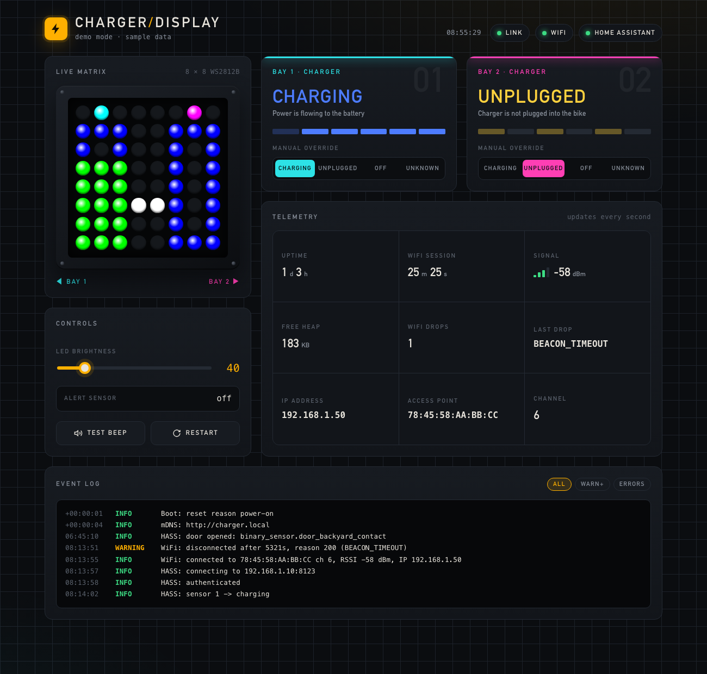

# Charger Display

A WiFi status display for two e-bike chargers tracked in Home Assistant. An ESP32 drives an 8x8 RGB LED matrix: the left half shows charger 1 and the right half shows charger 2. A buzzer beeps on state changes and door events.



## Hardware

| Part | Notes |
| --- | --- |
| ESP32-WROOM-32 dev board | FQBN `esp32:esp32:esp32` |
| 8x8 WS2812B matrix | Data on GPIO 23, wired row by row (not serpentine) |
| Active buzzer module | GPIO 13, active-low |

Pins are set in `main/config.h`.

## What the matrix shows

| Pattern | Meaning |
| --- | --- |
| Cyan (left) and magenta (right) frames, blue bar moving down | Charger is `charging` |
| Yellow zig-zag inside the frame | Charger is `disconnected` |
| Red blinking dots inside the frame | Charger state `unknown` |
| Red staircase, blue/red blinking corner | No WiFi |
| Blue staircase, green/yellow blinking corner | WiFi up, Home Assistant not connected |
| Yellow checkerboard | OTA update in progress (only if OTA is enabled) |

A single bright pixel moves one step around the border every second, so you can tell the firmware is alive.

## Quick start

1. Copy `main/secrets_template.h` to `main/secrets.h` and fill in your WiFi details, Home Assistant host, token, and the three sensor entity IDs.
2. Install [PlatformIO](https://platformio.org), connect the board over USB, then build and flash (details in [docs/platformio.md](docs/platformio.md)):
   ```sh
   pio run -t upload -t monitor
   ```
3. Optional: set `ENABLE_OTA 1` and `OTA_PASSWORD` in `secrets.h` before that first flash. Later updates then go over WiFi with `pio run -e ota -t upload`.
4. Open `http://charger.local`. The hostname is configurable. The dashboard shows the live matrix, both chargers with manual overrides, WiFi and Home Assistant health, brightness, and the event log.

PlatformIO installs the ESP32 core (Arduino-ESP32 3.2.0) and the libraries: `ArduinoJson` (7.x), `Adafruit NeoPixel`, `WebSockets` (Markus Sattler), `ArduinoWebsockets` (Gil Maimon). The sketch also opens in the Arduino IDE; see the last section of the PlatformIO guide.

## Documentation

- [docs/architecture.md](docs/architecture.md) covers the module layout, the main loop, and connection handling.
- [docs/api.md](docs/api.md) covers the REST API and the status WebSocket.
- [docs/wifi-troubleshooting.md](docs/wifi-troubleshooting.md) covers WiFi drops, Ubiquiti/UniFi settings, and how to read disconnect reasons.
- [docs/platformio.md](docs/platformio.md) covers compiling, USB flashing, and OTA updates with PlatformIO.
- [docs/development.md](docs/development.md) covers host tests, formatting, the web UI pipeline, and CI.
- [CONTEXT.md](CONTEXT.md) is the glossary, [docs/adr/](docs/adr/) records design decisions, and [CONTRIBUTING.md](CONTRIBUTING.md) explains how to contribute. Agents read [AGENTS.md](AGENTS.md).

## Repository layout

```
main/            Firmware (Arduino sketch, one module per .h/.cpp pair)
control-panel/   Source of the web UI, compiled into main/http_server_index.h
tests/host/      Unit tests for the Arduino-free logic (scripts/test.sh)
scripts/         test.sh, format.sh, and the OTA password helper for PlatformIO
platformio.ini   Build definition (board, core, partitions, libraries, usb/ota)
docs/            Architecture, API, PlatformIO, WiFi troubleshooting, ADRs
http-server/     Optional development tool: UDP log receiver with a web tail
.githooks/       pre-commit hook that regenerates the web UI header
```
